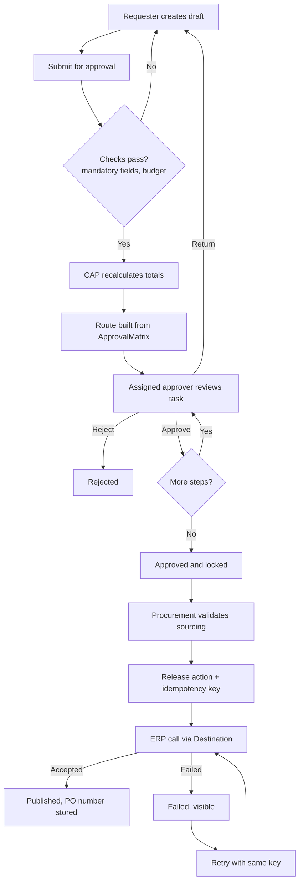
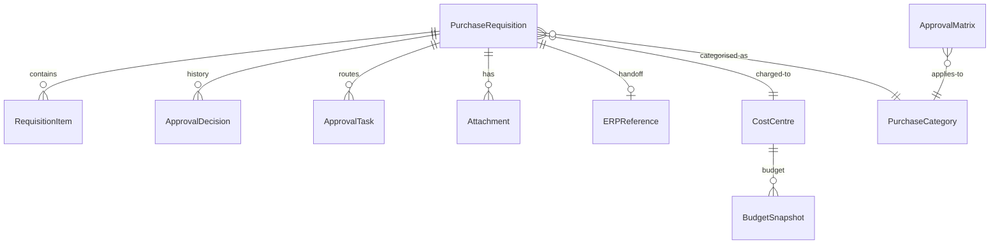

# Purchase Requisition and Multi-Level Approval

A requisition-to-approval application built on **SAP CAP (Node.js)** with **SAPUI5 / Fiori**. Requesters raise purchase requisitions, the system validates them and checks budget, approval routes are generated from a configurable matrix, approvers act on tasks, and approved requests are handed off to an external ERP as purchase orders.

> CAPM + Fiori training assignment 02 (individual project). Complexity: Advanced.

---

## 1. Business problem

Departments raise purchase requests by email, so budget visibility and approval routing are inconsistent. This application centralises the process:

- one place to capture requisitions (header + item lines)
- server-side calculation of totals and tax
- approval routing driven by configuration, not hard-coded logic
- full, immutable approval history
- reliable ERP hand-off with retry and no duplicates

## 2. Roles

| Role | XSUAA scope | Responsibility |
|---|---|---|
| Requester | `Requester` | Create, edit, submit, track and revise requisitions; cancel with reason |
| Department Manager | `Manager` | Review business need and department budget; approve / reject / return |
| Finance Approver | `Finance` | Check cost centre and available budget; approve / reject / return |
| Procurement Officer | `Procurement` | Validate sourcing, release approved requests to the ERP, retry failed hand-offs |
| Administrator | `Admin` | Maintain approval matrix, thresholds, cost centres and categories |

## 3. Business flow



### Status lifecycle

`Draft` → `Submitted / In Approval` → `Approved` → `Published`

Side states: `Returned` (back to requester), `Rejected`, `Cancelled`, `Failed` (ERP hand-off failed, retry allowed).

## 4. Key features

- Header/item aggregate with multiple lines, attachments, delivery locations, cost centres and project references
- Net amount, tax estimate and total calculated **in CAP**; totals sent by the UI are ignored
- Approval matrix by amount range, purchase category and organisational unit
- Actions: `submitForApproval`, `approve`, `reject`, `returnForCorrection`, `release`, `cancel`, `retryHandoff`
- Status-transition checks on every action
- Segregation of duties: a requester cannot approve their own request; only the currently assigned approver can act on a task
- Immutable approval history with mandatory decision comments
- Approved requisitions are locked; cancellation requires a recorded reason
- Outbound REST adapter using a BTP Destination, with an **idempotency key** and a mock ERP for local development
- Failed hand-offs remain visible and can be retried without creating duplicate purchase orders

## 5. Data model

Compositions: header → items, header → approval decisions (and attachments).

| Entity | Purpose |
|---|---|
| `PurchaseRequisition` | Header aggregate: requester, cost centre, currency, net/tax/total, status, project reference |
| `RequisitionItem` | Item lines: material/service, quantity, need-by date, estimated price, delivery location |
| `ApprovalDecision` | Immutable history of approve / reject / return with comment, approver, timestamp |
| `ApprovalTask` | Pending work item: step number, assigned approver/role, state |
| `ApprovalMatrix` | Configuration: amount range, category, organisational unit → required steps |
| `CostCentre` | Master data with department / organisational unit |
| `PurchaseCategory` | Master data for categories |
| `Attachment` | Supporting documents |
| `ERPReference` | External PO number, publication status, idempotency key, last error, retry count |
| `BudgetSnapshot` (optional) | Sample budget data per cost centre when ERP budget lookup is not used |



## 6. Architecture and SAP BTP services

| Service | Purpose |
|---|---|
| SAP HANA Cloud | Requisitions, approval configuration, budget snapshots, decision history |
| XSUAA | Role scopes for requester, manager, finance, procurement, admin |
| Destination service | Endpoint configuration for the CAP outbound REST adapter (budget lookup / PO hand-off) |
| SAP Audit Log / Application Logging | Approval traceability and outbound API diagnostics |
| SAP Build Process Automation (optional) | Multi-level approval orchestration; CAP remains owner of validations and transaction state |

## 7. UI (SAPUI5 / Fiori)

| App | Type | Description |
|---|---|---|
| Create / edit requisition | Custom wizard | Item table, value helps, live total preview |
| My Requisitions | Fiori Elements List Report + Object Page | Filters for status, amount, requester, date |
| Approver inbox | Custom UI5 | Approve / reject / return with comments and decision history |
| Procurement | Custom UI5 | ERP hand-off status and retry eligibility |
| Admin | Fiori Elements | Approval matrix, cost centres, categories |

## 8. Project structure

```
.
├── app/                    # Fiori apps (requisition wizard, my requisitions, approver inbox, procurement)
├── db/
│   ├── schema.cds          # Entities and compositions
│   └── data/               # Sample CSV data (cost centres, categories, matrix, budgets)
├── srv/
│   ├── requisition-service.cds   # Service definition + OData V4 API
│   ├── requisition-service.js    # Handlers: calculations, actions, status checks
│   └── lib/
│       ├── approval-router.js    # Builds ApprovalTask rows from ApprovalMatrix
│       └── erp-adapter.js        # Outbound REST client (Destination + idempotency key)
├── mock-erp/               # Mock ERP REST endpoint for local runs
├── test/                   # Unit / integration tests
├── xs-security.json        # XSUAA scopes and role templates
├── mta.yaml                # Deployment descriptor
└── package.json
```

## 9. Getting started

### Prerequisites

- Node.js (LTS) and npm
- `@sap/cds-dk` installed globally: `npm i -g @sap/cds-dk`
- For deployment: Cloud Foundry CLI, MBT, and a BTP subaccount with HANA Cloud, XSUAA and Destination service

### Run locally

```bash
npm install

# start the mock ERP (separate terminal)
npm run mock-erp

# start CAP with in-memory SQLite and sample data
cds watch
```

Open `http://localhost:4004`. Local mock users are defined in `package.json` under `cds.requires.auth`.

### Configuration

| Setting | Local | BTP |
|---|---|---|
| Database | SQLite (in-memory) | SAP HANA Cloud |
| Auth | Mocked users | XSUAA |
| ERP endpoint | `http://localhost:4010` (mock) | Destination `ERP_API` |

### Deploy to SAP BTP

```bash
cds build --production
mbt build
cf deploy mta_archives/<archive>.mtar
```

Then create the `ERP_API` destination in the subaccount and assign role collections to users.

## 10. OData V4 API (summary)

| Operation | Type | Who |
|---|---|---|
| `PurchaseRequisitions` | Entity set (CRUD while Draft/Returned) | Requester |
| `submitForApproval` | Bound action | Requester |
| `approve`, `reject`, `returnForCorrection` | Bound actions | Assigned approver |
| `cancel` | Bound action | Requester (reason required) |
| `release` | Bound action | Procurement |
| `retryHandoff` | Bound action | Procurement |
| `MyTasks` | Entity set / function | Approvers |

## 11. Business rules

- Approval steps are generated from `ApprovalMatrix`, never hard-coded in the UI.
- A requester cannot approve their own request.
- Only the current assigned approver can action a task.
- Approved requisitions cannot be edited; they can only be cancelled with a reason.
- Approval decisions are immutable.
- A failed ERP hand-off stays visible and retries reuse the same idempotency key.

## 12. Testing and acceptance

Test cases covered:

- [ ] Requisition below and above approval thresholds route differently
- [ ] Multi-line totals, tax and currency calculated correctly on the server
- [ ] Return for correction, revise and resubmit
- [ ] Reject closes the request
- [ ] Cancellation with a recorded reason
- [ ] Role checks, including requester attempting to approve their own request
- [ ] Invalid status transitions are blocked
- [ ] ERP failure shows Failed status; retry succeeds without duplicate PO

```bash
npm test
```

## 13. Assumptions

- Status names and the exact approval-matrix granularity are defined in `docs/assumptions.md`.
- Budget check uses sample `BudgetSnapshot` data unless an ERP budget endpoint is configured.
- `ApprovalDecision` is added as the history entity required by the BRD's composition requirement.

## 14. Deliverables

- [ ] BRD walkthrough and confirmed assumptions
- [ ] Process flow and role/authorization matrix
- [ ] CDS data model (ER diagram), service definition, OData V4 API
- [ ] CAP implementation
- [ ] Responsive SAPUI5 / Fiori application with validation messages
- [ ] Test evidence
- [ ] Deployment / README guide

## 15. Author

Member 02 - CAPM + Fiori training assignment.

## License

For training use.
